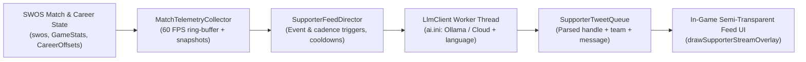

# Match Telemetry & Virtual Supporter Live Tweet Feed (`swos-port`)

## 1. Executive Summary

This report outlines the architecture and phased implementation plan for a **Lightweight Match Telemetry Engine** powering an in-game **Virtual Supporter Live Tweet Feed** (a semi-transparent social-stream overlay where rival and home fans react dynamically as the match unfolds).

Rather than reacting blindly to isolated events, virtual supporters receive a compact **Live Telemetry Snapshot** containing match momentum, shots/possession, pitch weather, player names, league table position, and career/manager records—all driven asynchronously via the existing `ai.ini` LLM client without impacting the 60 FPS match loop.

---

## 2. System Architecture



---

## 3. Telemetry Information Base (`MatchTelemetrySnapshot`)

All telemetry fields are read directly from existing C++ / SWOS VM state with zero gameplay mutation:

### A. Live Match Telemetry *(updated every ~30 frames & on major events)*
- **Match Clock, Exact Minute & Time-Pressure Phase:**
  - Exact current match minute (`0'–90'+` / `120'+` derived from `swos.gameTime`), current half (`swos.halfNumber`), extra time / penalties, and an explicit **time-pressure tag** computed from `(minute, goalDiff)`:
    - `0'–15'`: Early exchanges / settling in
    - `40'–45'+`: Approaching halftime
    - `75'–84'`: Closing stages (tension rising if margin <= 1)
    - `85'–90'+` / stoppage time: **Final minutes / "Squeaky Bum Time"** — leading fans beg the referee to blow the full-time whistle (*"Ref, blow the whistle already! Look at your watch!"*), while trailing fans plead for one last attack / late equalizer.
- **Scoreline & Pitch:** Current score (`statsTeam1Goals` – `statsTeam2Goals`) and resolved pitch condition (`getPitchType()` when `isPitchTypeResolved()`).
- **Live Statistics (`getStats()`):** Possession %, total shots (`goalAttempts`), shots on target, corners, fouls, yellow/red cards, and recent momentum (shots/territory in the last 10 match minutes).
- **Ball & Territory Tracking (`swos.ballSprite`):** Rolling 10-second pitch-zone ratio (`attacking third` / `midfield` / `defending third` for Team 1 vs Team 2) so fans know *who is dominating* even at `0–0`.
- **Key Events Ring Buffer (last 5 events):** Timestamped entries (`GOAL`, `OWN_GOAL`, `POST/BAR`, `SAVE`, `PENALTY`, `RED_CARD`, `YELLOW_CARD`, `INJURY`, `SUBSTITUTION`) with exact team & scorer/player name.
- **Goal Mechanics & Assist Attribution *(exact, zero-hallucination goal telemetry)*:**
  - **Assister Tracking:** Maintain a 2-slot ball-touch ring buffer (`lastTouchPlayer`, `prevTouchPlayer` with team, pitch coordinates, and timestamp) updated when a player kicks/contacts the ball. When `goalScored()` fires, if `prevTouchPlayer` is a different teammate within ~5 seconds, attribute the exact assist (plus detect **cross / wing / corner / free-kick assist** from `prevTouch` coordinates and prior stoppage state).
  - **Finish Type:** Read `swos.currentScorer->state` (`PlayerState::kStaticHeader` / `kJumpHeader` = header vs normal foot strike), `swos.penalty` (penalty kick), `swos.goalTypeScored` (own goal), and recent keeper/woodwork touch (rebound tap-in).
  - **Shot Distance, Placement & Speed:** Capture ball `(x, y, z)` and velocity `(deltaX, deltaY)` at shot release and goal-line crossing to classify **6-yard tap-in**, **penalty-box finish**, or **long-range screamer from outside the box**, as well as **top corner** (`ball.z` high near post) vs **low driven finish**.

### B. Club, Squad & Career Context *(captured once at kickoff)*
- **Teams & Roles:** Team 1 & Team 2 names, `[HUMAN]` vs `[CPU]` flags (resolved via `resolveTeam1AndTeam2` so halftime side-swaps never invert sides), coach names (`TeamFileHeader::coachName`), and starting XI / star players.
- **League Table & Stakes *(Career / League / Hotseat)*:**
  - Current division/league, club league position, points, goal difference, and opponent's league position (e.g., *"1st vs 18th"* or *"relegation six-pointer"*).
- **Management Record & Form *(Career / Hotseat)*:**
  - Recent match form (e.g., `W-W-D-L-W`), win/unbeaten/losing streak, chairman confidence, club cash/recent marquee signings (from `s_squadSnapshots` / career memory), and cup stage if applicable.

---

## 4. Virtual Supporter Tweet Feed Design

### A. Trigger Cadence & Rate Limiting
To keep local Ollama (`gemma4:latest`) and cloud APIs responsive and non-spammy:
- **High-Priority Event Triggers (immediate, bypass cooldown):**
  - Goal scored, own goal, penalty awarded/scored/saved/missed, red card, halftime, full-time.
- **Periodic Match-Flow Triggers (every ~15–20 real seconds if idle):**
  - Reacts to live telemetry momentum (e.g., *"68% possession and 9 shots, how is this still 0-0?!"*, *"Keeper is having a worldie today"*, *"We're 2nd in the league, can't drop points here!"*).
- **Batch Generation Efficiency:**
  - A single LLM call can request **2–3 short tweets** in one compact response (~120–180 tokens total), then stagger their arrival into the UI every 2–3 seconds so the stream feels genuinely alive with minimal inference load.

### B. Structured Output Format
Prompt the LLM to emit strict line-per-tweet format (in the configured `language` from `ai.ini`):
```text
@Kaiserslautern95|HOME|UNBELIEVABLE FINISH! TOP OF THE TABLE FORM!
@VfbFanatic|AWAY|DEFENCE IS WIDE OPEN AGAIN, WAKE UP LADS!
```
- Parsed deterministically into `{ handle, side (HOME/AWAY/NEUTRAL), text, timestamp }`.
- Transliterated cleanly through `sanitizeAsciiUpper` so non-English languages (`Turkish`, `German`, `Spanish`, etc.) never drop characters in SWOS's bitmap font.

---

## 5. In-Game Semi-Transparent UI Overlay

- **Placement & Footprint:**
  - Compact vertical panel anchored to the **top-right or bottom-right widescreen margin** (using `getGameScreenOffsetX()` so on 16:9 screens it sits neatly in the side margin without obscuring the pitch, and on 4:3 screens it sits cleanly in a slim semi-transparent corner strip).
- **Visual Style:**
  - Semi-transparent dark backdrop (`SDL_SetRenderDrawBlendMode(renderer, SDL_BLENDMODE_BLEND)` with `alpha ~140–160` + subtle 1px accent border).
  - Displays the **3 most recent tweets** (newest sliding in, oldest fading out after ~8–10 seconds).
  - Color-coded supporter handles (e.g., home club accent / away club accent / neutral white) with 1–2 wrapped lines per tweet using SWOS's small bitmap font (`drawText`).
- **Auto-Hide & Toggle:**
  - Automatically hidden during full-screen stats (`showingPostGameStats()` / `showingUserRequestedStats()`), pause menus, or replays if desired.
  - Controlled by `supporterStream = true/false` in `ai.ini` (`[features]`) and toggled directly in **Options -> LLM**, plus an optional in-match hotkey (e.g., `T`) to hide/show the feed on the fly.

---

## 6. Configuration (`ai.ini`) Extensions

```ini
[features]
supporterStream = true

[telemetry]
enabled = true
exportMatchJson = false        ; optional post-match JSON dump to telemetry/
streamUpdateSeconds = 18       ; periodic ambient fan tweet interval
maxVisibleTweets = 3
```

---

## 7. Phased Implementation Plan

### Phase 1 — Core Telemetry Collector (`src/telemetry/matchTelemetry.h/.cpp`)
1. Implement `MatchTelemetryCollector` hooked into `initMatch()`, `coreGameUpdate()` (sampled every 30 frames), `comments.cpp` (major events), and `gameLoop()` end / `VIEW RESULT`.
2. Track rolling ball territory thirds, shot/possession deltas, last-5 event ring buffer, and resolved club/coach/squad info.
3. Add a Career/League table reader (`extractLeagueTableContext()`) to pull current rank, points, opponent rank, and recent form.
4. *(Optional)* Export full-time JSON summary to `telemetry/` when `exportMatchJson = true`.

### Phase 2 — Supporter Tweet Prompting & Parser (`src/llm/supporterStream.h/.cpp`)
1. Build compact prompt serializer (~180 tokens) consuming `MatchTelemetrySnapshot` + `ai.ini` `language`.
2. Parse 2–3 `@handle|SIDE|message` lines per LLM response and release them into a display queue with a 2–3s stagger.
3. Enforce strict cooldowns and queue caps so the background `LlmClient` worker never backs up.

### Phase 3 — Semi-Transparent In-Game Stream UI (`drawSupporterStreamOverlay`)
1. Render the semi-transparent feed panel in `drawFrame()` (right before `drawStatsIfNeeded()`).
2. Add fade-in/fade-out alpha animation per tweet and auto-hide when stats or result overlays are active.
3. Add `SUPPORTER FEED` toggle to `llmOptions.mnu` / `llmOptionsMenu.cpp` and `ai.ini` (`packageWindows.py`), plus unit tests covering telemetry sampling, territory tracking, and tweet parsing.

---

## 8. Performance & Risk Summary

- **Zero 60 FPS impact:** Telemetry sampling updates a few floats/ints every 30 frames; all LLM calls run off-thread on the existing `LlmClient` worker.
- **Zero visual clutter on action:** Widescreen-aware margin placement + semi-transparent alpha + instant hotkey toggle keeps gameplay unobstructed.
- **Works in all modes:** Friendly, Cup, League, Single-Player Career, and Multi-League Hotseat (with richer league-table & manager-record context automatically unlocked in Career/League modes).
